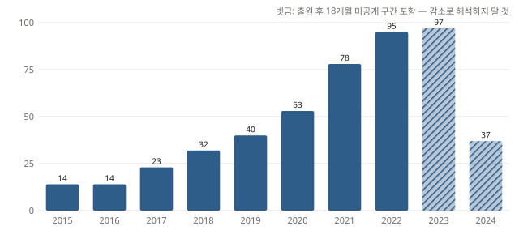
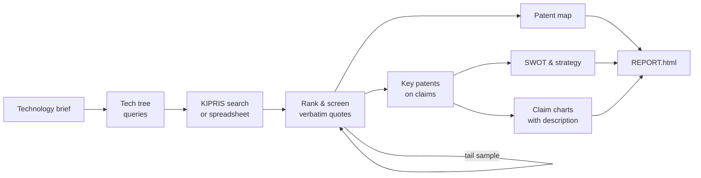

<div align="center">

# PARK

**Patent Analysis Research Kit — evidence-checked Korean patent analysis**

From a one-line technology brief to a landscape report, key patents, SWOT and claim charts.<br>
Claude Code skills make the judgements; a deterministic CLI does every count and every check.

[](https://github.com/j52367/park-patent/actions/workflows/ci.yml)
[](LICENSE)


[한국어](README.md) · **English**



<sub>Filing trend from the synthetic demo. The last 18 months are hatched: applications there are not yet published, so the dip is not a decline.</sub>

</div>

---

## Why PARK

Ask an LLM for a patent analysis and you quickly get a convincing report — with invented counts, evidence that is not in the source, and conclusions beyond what was searched.
PARK is built so those mistakes cannot slip through:

- **Only tools count.** Report prose states numbers through placeholders such as `{{meta.n_counted}}`; typed numbers are rejected by `park report --strict`.
- **Every judgement carries a verbatim quote**, machine-checked against the exact location it cites — abstract, claim *n*, or description paragraph.
- **It knows what it missed.** A random sample below the screening cut estimates how many relevant patents remain and reports **estimated recall with a 95% interval**.
- **No conclusions beyond the search scope.** Databases, countries, dates and queries are always stated; novelty or white space is never asserted.

## Features

| | |
|---|---|
| 🔎 **Search & import** | KIPRIS Plus API (cache, monthly call budget, 500 docs per call); spreadsheet import from KIPRIS, WIPS and other DBs (Korean headers, multi-country) |
| 🧭 **Classification & screening** | Technology tree with definition / include / exclude rules, learned pre-ranking (`park rank --learn`), per-round tail samples |
| 🗺️ **Patent map** | Filing trend, applicant ranking (name normalisation, nationality), technology matrices, country comparison, growth stage |
| ⭐ **Key patents** | Claims, forward citations and legal status from KIPRIS → key / notable / ordinary on independent claims, claim quotes verified |
| 📊 **SWOT & strategy** | Focal applicant vs competitors, rule-based S/W/O/T candidates, strategy proposals |
| ⚖️ **Claim charts** | Element split → earlier documents (incl. examiner citations) → novelty / inventive-step drafts using description paragraphs |
| 📄 **Report** | Single HTML file (light/dark) that always shows screening coverage, estimated recall and the disclaimer |

No GPU required; the synthetic demo runs without an API key.

## How it works



Skills (judgement) and the `park` CLI (counting, verification) exchange plain files under `analysis/<project>/`.
Judging can be done by Claude subagents or, optionally, in parallel by the [Codex CLI](scripts/codex-screen.sh).

## Quick start

```bash
git clone https://github.com/j52367/park-patent.git
cd park-patent
pip install -e ".[excel,learn,fulltext]"
park demo                      # full flow on synthetic data, no API key → analysis/demo/REPORT.html
park install-skills --user     # install the Claude Code skills
```

In Claude Code:

```text
/park-pipeline Analyse Korean patents on EV battery thermal management — project:bms-thermal
```

For live data, request the KIPRIS Plus Open API (free, approval required) at [plus.kipris.or.kr](https://plus.kipris.or.kr), put `KIPRIS_API_KEY` in `.env`, and check usage with `park quota` (1,000 calls/month on the free tier).

## Real-data validation

One real topic (~7,000 Korean candidates), end to end:

| | |
|---|---|
| Screening evidence | 2,880 quotes, all found verbatim in the source |
| Estimated recall | ≈ 87% (95% interval 73–94%) from tail samples |
| Pre-ranking | Learned char-n-gram ranking beat multilingual embeddings (bge-m3, e5-large, KURE): tail AP 0.47 → 0.80, seconds on CPU ([experiment](docs/experiments/2026-11-09_ranking.md)) |
| Key patents | 300 claim quotes verified against the named claim; mean forward citations 16.1 / 5.8 / 1.4 by grade |
| Claim charts | Adding description paragraphs corrected 5 of 40 element judgements |

## Limitations

- **Not legal advice** — drafts for a patent attorney ([DISCLAIMER](DISCLAIMER.md)).
- Quotes are verified to *exist*; whether a judgement is *right* still needs sampling and human review.
- Text similarity does not replace an examiner's search; include examiner citations and documents you know in claim charts.
- Drawings are not read. Overseas patents and infringement charts are on the roadmap.

## Roadmap

- [ ] Overseas patents (KIPRIS overseas API: US / EP / JP / CN / PCT)
- [ ] Infringement / design-around charts (product vs claims)
- [ ] Drawing interpretation
- [ ] Korean patent retrieval model and a KR invalidity-evidence benchmark

Design notes and decisions: [docs/DESIGN.md](docs/DESIGN.md) (Korean).

## Contributing

Issues and PRs are welcome — see [CONTRIBUTING.md](CONTRIBUTING.md).

## Related projects

[ARIS](https://github.com/wanshuiyin/Auto-claude-code-research-in-sleep) (inspiration for composable Markdown skills and cross-model review) ·
[claude-for-legal](https://github.com/anthropics/claude-for-legal) ·
[PatentAgentBench](https://github.com/patsnap/PatentAgentBench)

## License

[Apache-2.0](LICENSE). Data obtained from KIPRIS is subject to the KIPRIS Plus terms and is not included in this repository. Demo and test data are fictional.
