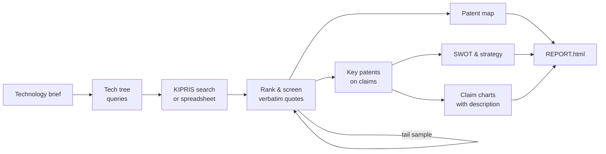

<div align="center">

# PARK

**Patent Analysis Research Kit**

Evidence-checked Korean patent analysis

[](https://github.com/j52367/park-patent/actions/workflows/ci.yml)
[](LICENSE)


[한국어](README.md) · **English**

</div>

---

From a one-line technology brief to a landscape report,<br>
key patents, SWOT and claim charts.

Claude Code skills make the judgements; the `park` CLI does every count and check.

## Why PARK

Ask an LLM for a patent analysis and you quickly get a convincing report —<br>
with invented counts and evidence that is not in the source.<br>
PARK is built so those mistakes cannot slip through.

- **Only tools count**
  - Report prose uses placeholders such as `{{meta.n_counted}}`
  - Typed numbers are rejected by `park report --strict`
- **Every judgement carries a verbatim quote**
  - Each quote names its location: abstract, claim, or paragraph
  - The quote is machine-checked against that exact location
- **It knows what it missed**
  - A random sample is drawn from the unscreened documents
  - Reports show how many relevant patents remain, and estimated recall
- **No conclusions beyond the search scope**
  - Databases, countries, dates and queries are always stated
  - Novelty or white space is never asserted

## Features

- 🔎 **Search & import**
  - KIPRIS Plus API (cache, monthly call budget)
  - Spreadsheets from KIPRIS, WIPS and other DBs (multi-country)
- 🧭 **Classification & screening**
  - Technology tree with definition / include / exclude rules
  - Learned pre-ranking (`park rank --learn`)
  - Per-round tail samples to estimate what is left
- 🗺️ **Patent map**
  - Filing trend, applicant ranking, technology matrices
  - Country comparison, growth stage
- ⭐ **Key patents**
  - Claims, forward citations and legal status from KIPRIS
  - Key / notable / ordinary on independent claims
- 📊 **SWOT & strategy**
  - Focal applicant vs competitors
  - Rule-based S/W/O/T candidates and strategy proposals
- ⚖️ **Claim charts**
  - Element split, earlier documents before the priority date
  - Examiner citations and description paragraphs included
- 📄 **Report**
  - A single HTML file (light/dark)
  - Screening coverage, estimated recall and disclaimer

No GPU required; the demo runs without an API key.

## How it works



Skills and the CLI exchange plain files under `analysis/<project>/`.

Judging is done by Claude subagents or,<br>
optionally, in parallel by the [Codex CLI](scripts/codex-screen.sh).

## Quick start

```bash
git clone https://github.com/j52367/park-patent.git
cd park-patent
pip install -e ".[excel,learn,fulltext]"

# full flow on synthetic data
park demo
```

The report is written to `analysis/demo/REPORT.html`.

### Analyse with Claude Code

```bash
park install-skills --user
```

```text
/park-pipeline Korean patents on EV battery thermal management — project:bms
```

The pipeline stops for confirmation at every step.

### Connect KIPRIS Plus (optional)

1. Request the Open API at [KIPRIS Plus](https://plus.kipris.or.kr) (free)
2. Copy `.env.example` to `.env` and add your key
3. Check usage with `park quota` (free tier: 1,000 calls/month)

Without a key, import downloaded spreadsheets with `park ingest`.

## Skills

| Skill | What it does |
|---|---|
| `/park-pipeline` | Full flow with confirmations |
| `/tech-scoping` | Technology tree and queries |
| `/kipris-search` | KIPRIS search or spreadsheet import |
| `/relevance-screening` | Noise / valid screening, tail samples |
| `/patent-map` | Trend, applicant and technology counts |
| `/park-report` | Interpretation and HTML report |
| `/key-patent-review` | Key patents on claims |
| `/ip-strategy` | Patent-based SWOT and strategy |
| `/claim-chart-kr` | Claim charts (novelty, inventive step) |

## CLI

| Command | Purpose |
|---|---|
| `park init` | Create an analysis folder |
| `park ingest` | Import CSV / Excel |
| `park search` | KIPRIS search |
| `park quota` | API calls this month |
| `park rank` | Rank candidates (`--learn`: learned) |
| `park batches` | Build screening batches |
| `park merge-screening` | Merge and verify screening |
| `park audit-sample` | Draw a tail sample |
| `park map` | Counts and charts |
| `park check` | Quote, code and number checks |
| `park shortlist` | Pick phase-2 documents |
| `park enrich` | Claims, citations, legal status |
| `park review-batches` | Key-patent review batches |
| `park merge-review` | Merge review, verify claim quotes |
| `park swot` | SWOT counts and candidates |
| `park chart` | Prepare a claim chart |
| `park merge-chart` | Merge and verify a claim chart |
| `park report` | HTML report |
| `park install-skills` | Install Claude Code skills |
| `park demo` | Synthetic demo |

## Real-data validation

One real topic (~7,000 Korean candidates), end to end:

| | |
|---|---|
| Screening quotes | 2,880, all found verbatim |
| Estimated recall | ≈ 87% (95% interval 73–94%) |
| Pre-ranking | Learned ranking beat embedding models ([experiment](docs/experiments/2026-11-09_ranking.md)) |
| Key patents | 300 claim quotes verified |
| Claim charts | Description paragraphs corrected 5 judgements |

## Roadmap

- [ ] Overseas patents (US / EP / JP / CN / PCT)
- [ ] Infringement / design-around charts
- [ ] Drawing interpretation
- [ ] Korean patent retrieval model and benchmark

Design notes (Korean): [docs/DESIGN.md](docs/DESIGN.md)

## Related projects

- [ARIS](https://github.com/wanshuiyin/Auto-claude-code-research-in-sleep): inspiration for composable Markdown skills
- [claude-for-legal](https://github.com/anthropics/claude-for-legal): Claude plugins for US IP practice
- [PatentAgentBench](https://github.com/patsnap/PatentAgentBench): a benchmark for patent agents

## License

[Apache-2.0](LICENSE)

- KIPRIS data follows the KIPRIS Plus terms and is not in this repository
- Demo and test data are fictional
- Outputs are not legal advice ([DISCLAIMER](DISCLAIMER.md))
