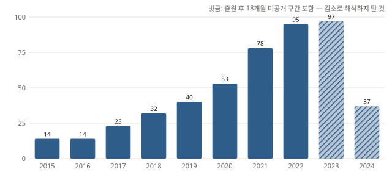
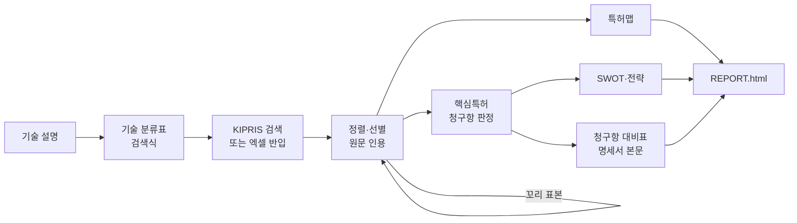
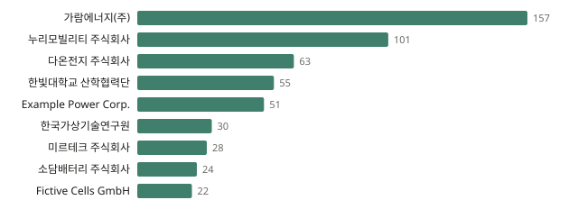
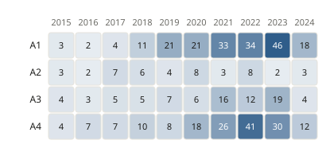

<div align="center">

# PARK

**Patent Analysis Research Kit — 근거로 검증되는 한국 특허 분석**

기술 설명 한 줄에서 특허 동향 보고서·핵심특허·SWOT·청구항 대비표까지.<br>
판단은 LLM이, 숫자와 검증은 결정적 도구가 맡는 Claude Code 스킬 + CLI.

[](https://github.com/j52367/park-patent/actions/workflows/ci.yml)
[](LICENSE)


**한국어** · [English](README.en.md)



<sub>합성 데모 데이터로 만든 연도별 출원 동향. 출원 후 18개월 미공개 구간은 빗금으로 표시해 '감소'로 오독하지 않게 합니다.</sub>

</div>

---

## 왜 PARK인가

LLM에게 특허 분석을 맡기면 그럴듯한 보고서가 금방 나옵니다. 그런데 건수를 지어내거나, 원문에 없는 근거를 대거나, 검색하지 않은 범위까지 단정하기 쉽습니다.
PARK는 이런 실수를 **구조적으로 막는** 분석 도구입니다.

- **숫자는 도구만 셉니다.** 보고서 문장은 `{{meta.n_counted}}` 같은 자리표시자로만 숫자를 쓰고, 직접 쓴 숫자는 `park report --strict`가 막습니다.
- **모든 판정에 원문 인용이 붙습니다.** 선별, 핵심특허, 청구항 대비의 인용문을 지정한 위치(요약, 청구항 n, 명세서 단락)의 원문과 기계로 대조합니다.
- **놓친 양을 압니다.** 선별 컷 아래에서 무작위 표본을 뽑아 남은 유효특허 수와 **추정 재현율(95% 신뢰구간)**을 보고서에 싣습니다.
- **범위를 넘는 결론을 쓰지 않습니다.** 검색 범위(DB, 국가, 기간, 검색식)를 항상 밝히고, 신규성이나 공백기술을 단정하지 않습니다.

## 주요 기능

- 🔎 **검색과 반입**
  - KIPRIS Plus API: 캐시, 월 호출 한도 관리, 한 번에 500건
  - KIPRIS·WIPS 등 엑셀/CSV 반입: 한글 헤더 자동 인식, 다국가
- 🧭 **기술 분류와 선별**
  - 정의·포함·제외 기준이 있는 기술 분류표
  - 판정을 학습하는 사전 정렬(`park rank --learn`)
  - 라운드별 꼬리 표본
- 🗺️ **특허맵:** 연도별 동향, 출원인 순위(이름 정규화·국적), 기술분류 매트릭스, 국가 비교, 기술 성장 단계
- ⭐ **핵심특허:** 청구항·피인용·법적상태를 수집하고, 독립항 기준으로 핵심·주목·일반을 판정. 청구항 원문 인용을 검증
- 📊 **SWOT·전략:** 초점 출원인 대 경쟁 출원인 집계, 규칙 기반 S·W·O·T 후보, 전략 제안
- ⚖️ **청구항 대비표:** 구성요소 분할 → 기준일 이전 선행문헌(심사관 인용 포함) → 명세서 본문까지 대조한 신규성·진보성 초안
- 📄 **보고서:** 단일 HTML(라이트/다크). 선별 범위, 추정 재현율, 면책 안내를 항상 표시

GPU가 필요 없고, API 키 없이도 합성 데이터 데모가 돌아갑니다.

## 작동 방식



각 단계는 **Claude Code 스킬(판단)**과 **`park` CLI(집계·검증)**가 파일(`analysis/<프로젝트>/`)을 주고받으며 진행합니다.
판정은 Claude 서브에이전트가 하거나, 선택적으로 [Codex CLI](scripts/codex-screen.sh)에 병렬로 맡길 수 있습니다.

## 빠른 시작

```bash
git clone https://github.com/j52367/park-patent.git
cd park-patent
pip install -e ".[excel,learn,fulltext]"

# API 키 없이 합성 데이터로 전체 흐름 실행 → analysis/demo/REPORT.html
park demo
```

### Claude Code에서 분석하기

```bash
# 스킬을 ~/.claude/skills에 설치 (프로젝트 단위로 설치하려면 --project <폴더>)
park install-skills --user
```

```text
/park-pipeline 전기차 배터리 열관리 기술의 국내 특허 동향 분석 — project:bms
```

파이프라인은 기술 분류표, 검색식, 선별 결과를 확정할 때마다 멈추고 사용자 확인을 받습니다.

### KIPRIS Plus 연결 (선택)

1. [KIPRIS Plus](https://plus.kipris.or.kr)에서 Open API를 신청합니다. 무료이고 관리자 승인이 필요합니다.
   - 필수: **특허·실용 공개·등록공보**
   - 선택: 피인용, 패밀리, 해외특허 등
2. `.env.example`을 `.env`로 복사하고 `KIPRIS_API_KEY`를 넣습니다.
3. `park quota`로 이번 달 사용량을 확인합니다. 무료 한도는 월 1,000회 호출입니다.

키가 없어도 KIPRIS 웹이나 상용 DB에서 내려받은 엑셀을 `park ingest`로 쓸 수 있습니다.

## 스킬

| 스킬 | 하는 일 |
|---|---|
| `/park-pipeline` | 전체 흐름을 순서대로 실행하고 단계마다 확인받기 |
| `/tech-scoping` | 기술 분류표(정의·포함·제외)와 검색식 설계 |
| `/kipris-search` | KIPRIS 검색 또는 엑셀/CSV 반입, 검색 범위 기록 |
| `/relevance-screening` | 노이즈/유효 선별, 학습 정렬, 꼬리 표본, 거짓음성 점검 |
| `/patent-map` | 출원 동향·출원인·기술분류·국가 집계와 차트 |
| `/park-report` | 해석 작성(숫자는 자리표시자)과 HTML 보고서 |
| `/key-patent-review` | 청구항 원문 기반 핵심특허 판정 |
| `/ip-strategy` | 특허 기반 SWOT와 전략 제안 |
| `/claim-chart-kr` | 청구항 대비표 (신규성·진보성) |

## CLI

<details>
<summary><code>park</code> 명령 전체 보기</summary>

| 명령 | 설명 |
|---|---|
| `park init <dir>` | 분석 폴더와 템플릿 만들기 |
| `park ingest <files> --out <dir>` | CSV/엑셀 반입 (한글·WIPS 헤더 인식, 다국가) |
| `park search --word "<식>" --out <dir>` | KIPRIS 검색 (`--count-only`로 건수만) |
| `park quota` | 이번 달 API 호출 수 |
| `park rank <dir> [--learn]` | 분류표 유사도 정렬, 또는 판정으로 학습한 정렬 |
| `park batches` · `merge-screening` · `audit-sample` | 선별 배치, 결과 병합·검증, 꼬리 표본 |
| `park map <dir>` | 집계(`map/stats.json`)와 SVG 차트 |
| `park check <dir>` | 인용·분류 코드·보고서 숫자 검사 |
| `park shortlist` · `enrich` | 2단계 대상 압축, 청구항·피인용·법적상태 수집 |
| `park review-batches` · `merge-review` | 핵심특허 판정 배치와 청구항 인용 검증 |
| `park swot <dir> --focal <출원인> --vs <경쟁>` | SWOT 집계와 후보 |
| `park chart` · `merge-chart` | 청구항 대비표 (`--examiner`, `--fulltext`, `--include`) |
| `park report <dir> [--strict]` | HTML 보고서 |
| `park install-skills` | Claude Code 스킬 설치 |
| `park demo` | 합성 데이터 데모 |

</details>

## 보고서 예시

<table>
<tr>
<td width="50%"><br><sub>주요 출원인 — 표기가 다른 같은 회사(예: "(주)", "주식회사")를 합쳐 셉니다</sub></td>
<td width="50%"><br><sub>기술 분류 × 출원연도</sub></td>
</tr>
</table>

<sub>모든 예시 이미지는 가상의 기업과 문헌으로 만든 합성 데모 데이터입니다.</sub>

보고서에는 이 밖에도 다음이 들어갑니다:
- 선별 범위와 추정 재현율
- 국가 비교
- 핵심특허 표
- 출원인 × 기술분류 SWOT 매트릭스
- 청구항 대비표 (● 개시 · ◐ 일부 · ○ 미개시, 칸마다 근거 인용)

## 실제 데이터 검증

실제 주제 하나(KR 후보 약 7천 건)에 PARK를 처음부터 끝까지 적용한 결과입니다.

| 항목 | 결과 |
|---|---|
| 선별 근거 인용 | 2,880건 모두 원문과 일치 |
| 추정 재현율 | 약 87% (95% 신뢰구간 73–94%), 꼬리 표본 기반 |
| 사전 정렬 | 판정 학습 정렬이 다국어 임베딩(bge-m3, e5-large, KURE)보다 우수. 꼬리 표본 AP 0.47 → 0.80, CPU 수 초 ([실험 기록](docs/experiments/2026-11-09_ranking.md)) |
| 핵심특허 판정 | 청구항 인용 300건 모두 지정 청구항 원문과 일치. 등급별 평균 피인용 16.1 / 5.8 / 1.4 |
| 청구항 대비 | 명세서 본문을 넣자 판정 40건 중 5건이 정정됨 (본문에만 있는 형상 기재 등) |
| 사람이 만든 표 재현 | 상용 DB 엑셀(5개국, 사람 판정) 반입 → 국가 × 기술 표 합계 일치 |

## 한계

- **법률 의견이 아닙니다.** 모든 산출물은 변리사 검토를 위한 초안입니다 ([DISCLAIMER](DISCLAIMER.md)).
- 판정은 LLM이 합니다. 인용이 원문에 **있는지**는 기계로 확인하지만, 판정이 **옳은지**는 표본 검토와 사람의 확인이 필요합니다.
- 글자 유사도 검색은 심사관 검색을 대신하지 못합니다. 청구항 대비에는 심사관 인용과 사용자가 아는 문헌을 함께 넣으세요.
- 도면 이미지는 해석하지 않습니다. 해외 특허 API 연동, 침해·회피설계 대비표는 아직입니다.

## 로드맵

- [ ] 해외 특허 (KIPRIS 해외특허 API: US·EP·JP·CN·PCT)
- [ ] 침해·회피설계 대비표 (제품 설명 대 청구항)
- [ ] 도면 해석
- [ ] 한국어 특허 검색 모델과 KR 무효 근거 벤치마크

설계와 결정 기록은 [docs/DESIGN.md](docs/DESIGN.md)에 있습니다.

## 기여하기

이슈와 PR을 환영합니다. 특히 다음이 큰 도움이 됩니다.
- 새 DB 내보내기 헤더 (`park/ingest.py`의 `HEADER_SYNONYMS`)
- KIPRIS API 확인 결과 ([docs/kipris-api-notes.md](docs/kipris-api-notes.md))
- 출원인 별칭 규칙
- 새로운 분석 스킬

자세한 내용은 [CONTRIBUTING.md](CONTRIBUTING.md)를 보세요.

## 관련 프로젝트

- [ARIS](https://github.com/wanshuiyin/Auto-claude-code-research-in-sleep): Markdown 스킬 조합과 다른 모델의 교차 검토 구조에서 영감을 받았습니다. ARIS의 특허 기능은 출원서 작성(CN/US/EP), PARK는 한국 특허 분석입니다.
- [claude-for-legal](https://github.com/anthropics/claude-for-legal): 미국 IP 실무용 Claude 플러그인
- [PatentAgentBench](https://github.com/patsnap/PatentAgentBench): 특허 에이전트 벤치마크

## 라이선스

[Apache-2.0](LICENSE).
- KIPRIS에서 받은 데이터는 KIPRIS Plus 이용약관을 따르며, 이 저장소에 포함되지 않습니다.
- 데모와 테스트 데이터는 모두 가상입니다.
