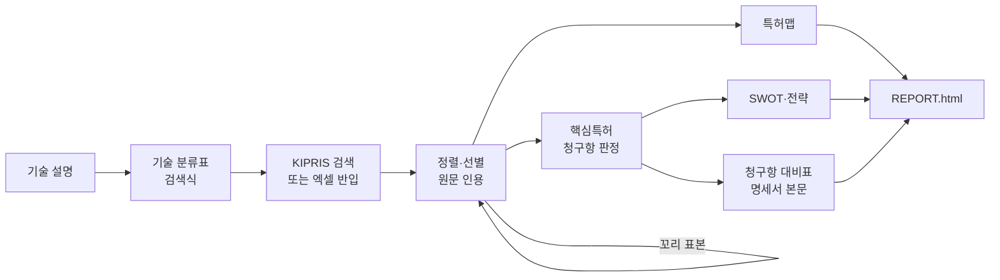

<div align="center">

# PARK

**Patent Analysis Research Kit**

근거로 검증되는 한국 특허 분석 도구

[](https://github.com/j52367/park-patent/actions/workflows/ci.yml)
[](LICENSE)


**한국어** · [English](README.en.md)

</div>

---

기술 설명 한 줄로 시작해 특허 동향 보고서, 핵심특허,<br>
SWOT, 청구항 대비표까지 만듭니다.

판단은 Claude Code 스킬이, 숫자와 검증은 `park` CLI가 맡습니다.

## 왜 PARK인가

LLM에게 특허 분석을 맡기면 그럴듯한 보고서가 금방 나옵니다.<br>
하지만 건수를 지어내거나, 원문에 없는 근거를 대기 쉽습니다.<br>
PARK는 이런 실수를 구조적으로 막습니다.

- **숫자는 도구만 셉니다**
  - 보고서 문장은 `{{meta.n_counted}}` 같은 자리표시자를 씁니다
  - 직접 쓴 숫자는 `park report --strict`가 막습니다
- **모든 판정에 원문 인용이 붙습니다**
  - 요약, 청구항, 명세서 단락 등 인용 위치를 지정합니다
  - 인용문이 그 위치에 실제로 있는지 기계로 대조합니다
- **놓친 양을 압니다**
  - 선별하지 않은 구간에서 무작위 표본을 뽑습니다
  - 남은 유효특허 수와 추정 재현율을 보고서에 싣습니다
- **범위를 넘는 결론을 쓰지 않습니다**
  - 검색 범위(DB, 국가, 기간, 검색식)를 항상 밝힙니다
  - 신규성이나 공백기술을 단정하지 않습니다

## 주요 기능

- 🔎 **검색과 반입**
  - KIPRIS Plus API (캐시, 월 호출 한도 관리)
  - KIPRIS·WIPS 등 엑셀/CSV 반입 (한글 헤더, 다국가)
- 🧭 **기술 분류와 선별**
  - 정의·포함·제외 기준이 있는 기술 분류표
  - 판정을 학습하는 사전 정렬 (`park rank --learn`)
  - 라운드별 꼬리 표본으로 남은 양 추정
- 🗺️ **특허맵**
  - 연도별 동향, 출원인 순위, 기술분류 매트릭스
  - 국가 비교, 기술 성장 단계
- ⭐ **핵심특허**
  - 청구항·피인용·법적상태 수집
  - 독립항 기준 핵심·주목·일반 판정
- 📊 **SWOT·전략**
  - 초점 출원인 대 경쟁 출원인 비교
  - 규칙 기반 S·W·O·T 후보와 전략 제안
- ⚖️ **청구항 대비표**
  - 구성요소 분할, 기준일 이전 선행문헌 선정
  - 심사관 인용 문헌과 명세서 본문까지 대조
- 📄 **보고서**
  - 단일 HTML 파일 (라이트/다크 모드)
  - 선별 범위, 추정 재현율, 면책 안내 포함

GPU가 필요 없고, API 키 없이도 데모가 돌아갑니다.

## 작동 방식



스킬(판단)과 CLI(집계·검증)는 `analysis/<프로젝트>/` 폴더의<br>
파일을 주고받으며 진행합니다.

판정은 Claude 서브에이전트가 하거나,<br>
[Codex CLI](scripts/codex-screen.sh)에 병렬로 맡길 수 있습니다.

## 빠른 시작

```bash
git clone https://github.com/j52367/park-patent.git
cd park-patent
pip install -e ".[excel,learn,fulltext]"

# 합성 데이터로 전체 흐름 실행
park demo
```

결과는 `analysis/demo/REPORT.html`에 생깁니다.

### Claude Code에서 분석하기

```bash
park install-skills --user
```

```text
/park-pipeline 전기차 배터리 열관리 특허 동향 — project:bms
```

파이프라인은 단계마다 멈추고 사용자 확인을 받습니다.

### KIPRIS Plus 연결 (선택)

1. [KIPRIS Plus](https://plus.kipris.or.kr)에서 Open API를 신청합니다
   - 필수: 특허·실용 공개·등록공보
   - 선택: 피인용, 패밀리, 해외특허
2. `.env.example`을 `.env`로 복사하고 키를 넣습니다
3. `park quota`로 사용량을 확인합니다 (무료: 월 1,000회)

키가 없으면 내려받은 엑셀을 `park ingest`로 쓰면 됩니다.

## 스킬

| 스킬 | 하는 일 |
|---|---|
| `/park-pipeline` | 전체 흐름 실행, 단계마다 확인 |
| `/tech-scoping` | 기술 분류표와 검색식 |
| `/kipris-search` | KIPRIS 검색, 엑셀/CSV 반입 |
| `/relevance-screening` | 노이즈/유효 선별, 꼬리 표본 |
| `/patent-map` | 동향·출원인·기술분류 집계 |
| `/park-report` | 해석 작성과 HTML 보고서 |
| `/key-patent-review` | 청구항 기반 핵심특허 판정 |
| `/ip-strategy` | 특허 기반 SWOT와 전략 |
| `/claim-chart-kr` | 청구항 대비표 (신규성·진보성) |

## CLI

| 명령 | 설명 |
|---|---|
| `park init` | 분석 폴더 만들기 |
| `park ingest` | CSV/엑셀 반입 |
| `park search` | KIPRIS 검색 |
| `park quota` | 이번 달 API 호출 수 |
| `park rank` | 후보 정렬 (`--learn`: 학습 정렬) |
| `park batches` | 선별 배치 만들기 |
| `park merge-screening` | 선별 결과 병합·검증 |
| `park audit-sample` | 꼬리 표본 뽑기 |
| `park map` | 집계와 차트 |
| `park check` | 인용·코드·숫자 검사 |
| `park shortlist` | 2단계 대상 압축 |
| `park enrich` | 청구항·피인용·법적상태 수집 |
| `park review-batches` | 핵심특허 판정 배치 |
| `park merge-review` | 판정 병합, 청구항 인용 검증 |
| `park swot` | SWOT 집계와 후보 |
| `park chart` | 청구항 대비표 준비 |
| `park merge-chart` | 대비표 병합·검증 |
| `park report` | HTML 보고서 |
| `park install-skills` | Claude Code 스킬 설치 |
| `park demo` | 합성 데이터 데모 |

## 실제 데이터 검증

실제 주제 하나(KR 후보 약 7천 건)에 처음부터 끝까지 적용했습니다.

| 항목 | 결과 |
|---|---|
| 선별 근거 인용 | 2,880건 모두 원문과 일치 |
| 추정 재현율 | 약 87% (95% 신뢰구간 73–94%) |
| 사전 정렬 | 학습 정렬이 임베딩 모델보다 우수 ([실험](docs/experiments/2026-11-09_ranking.md)) |
| 핵심특허 판정 | 청구항 인용 300건 모두 원문과 일치 |
| 청구항 대비 | 명세서 본문 반영으로 판정 5건 정정 |

## 로드맵

- [ ] 해외 특허 (US·EP·JP·CN·PCT)
- [ ] 침해·회피설계 대비표
- [ ] 도면 해석
- [ ] 한국어 특허 검색 모델과 벤치마크

설계와 결정 기록: [docs/DESIGN.md](docs/DESIGN.md)

## 관련 프로젝트

- [ARIS](https://github.com/wanshuiyin/Auto-claude-code-research-in-sleep): Markdown 스킬 구조에서 영감
- [claude-for-legal](https://github.com/anthropics/claude-for-legal): 미국 IP 실무용 Claude 플러그인
- [PatentAgentBench](https://github.com/patsnap/PatentAgentBench): 특허 에이전트 벤치마크

## 라이선스

[Apache-2.0](LICENSE)

- KIPRIS 데이터는 KIPRIS Plus 이용약관을 따르며 저장소에 없습니다
- 데모와 테스트 데이터는 모두 가상입니다
- 모든 산출물은 법률 의견이 아닙니다 ([DISCLAIMER](DISCLAIMER.md))
